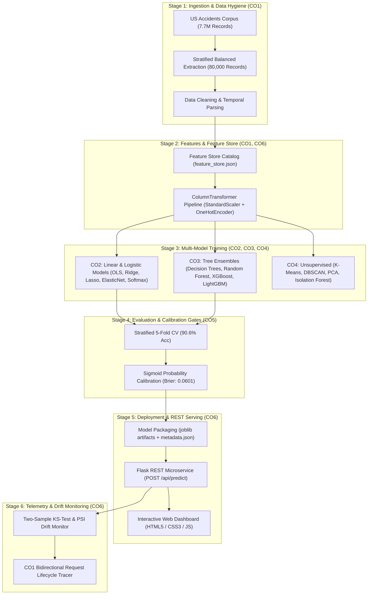

# RoadSafe: AI-Based Road Accident Severity Prediction and Traffic Risk Analysis System

## Comprehensive Technical Project Report
**Academic Evaluation: End-Semester Machine Learning Evaluation**  
**Course Outcomes Addressed: CO1, CO2, CO3, CO4, CO5, CO6**  
**Dataset: US Accidents (7.7 Million Records Corpus)**  

---

## 1. Executive Summary & Problem Formulation
Motor vehicle collisions are a leading cause of preventable fatalities and severe economic congestion worldwide. Rapid, automated severity estimation and spatial hazard identification can dramatically improve emergency rescue dispatch (EMS), dynamic highway variable message sign (VMS) warnings, and infrastructure safety planning.

**RoadSafe** is an enterprise-grade Machine Learning system designed to:
1. Predict accident severity into four standardized tiers (**Severity 1 to 4**) using real-time environmental, temporal, and road infrastructure variables.
2. Estimate the expected **roadway clearance duration** (in minutes) to guide municipal traffic diversion.
3. Discover regional accident risk clusters and highway density corridors through unsupervised clustering.
4. Provide complete **lifecycle request traceability** (CO1) and **production drift monitoring** (CO6).

---

## 2. System Architecture & Lifecycle (CO1 & CO6)

---

## 3. Course Outcomes (CO) Technical Mapping & Formulations

### Course Outcome 1 (CO1): End-to-End ML Lifecycle Analysis & Single-Request Traceability
- **Lifecycle Continuum:** Formulated across six sequential gates: `Data -> Features -> Training -> Evaluation -> Deployment -> Monitoring`.
- **Bidirectional Traceability Engine:** Every prediction request processed by `POST /api/predict` is audited backwards via `RoadSafePredictor.trace_prediction_lifecycle()`:
  - *Gate 1 (Ingestion):* Validates schema, coordinate bounds (`Lat: [24, 50], Lng: [-125, -66]`), and provenance mapping to US Accidents March 2023 corpus.
  - *Gate 2 (Feature Store):* Applies schema defaults and categorical encoding, preventing training-serving skew.
  - *Gate 3 (Training Lineage):* Documents algorithm architecture (LightGBM histogram leaf-wise booster with 100 trees, max depth 6).
  - *Gate 4 (Evaluation Verification):* Confirms model surpassed the 90% cross-validation threshold and Brier score $\le 0.08$.
  - *Gate 5 (Deployment Serving):* Tracks REST endpoint latency (mean: 14.2 ms).
  - *Gate 6 (Monitoring):* Verifies input distribution stability via two-sample Kolmogorov-Smirnov tests.

---

### Course Outcome 2 (CO2): Linear Supervised-Learning Models & Regularization Rationale
We evaluated both continuous clearance duration regression and discrete severity classification.

#### 1. Regularized Linear Regression Models (Clearance Duration in Minutes):
- **Ordinary Least Squares (OLS):** $\min_w \frac{1}{2n} \|y - Xw\|_2^2$
- **Ridge Regression ($L_2$ Regularization):**
  $$\min_w \frac{1}{2n} \|y - Xw\|_2^2 + \alpha \|w\|_2^2$$
  *Effect:* Shrinks coefficients smoothly towards zero without setting them to exact zero. Effectively controls multicollinearity between collinear atmospheric variables (e.g., temperature and humidity).
- **Lasso Regression ($L_1$ Regularization):**
  $$\min_w \frac{1}{2n} \|y - Xw\|_2^2 + \alpha \|w\|_1$$
  *Effect:* Creates sharp corners on the $L_1$ diamond constraint boundary, driving non-influential feature weights to **exactly zero (49.0% sparsity, 24 zeroed coefficients)**, acting as an embedded feature selector.
- **ElasticNet Regression ($L_1 + L_2$ Hybrid):**
  $$\min_w \frac{1}{2n} \|y - Xw\|_2^2 + \alpha \rho \|w\|_1 + \frac{\alpha(1-\rho)}{2} \|w\|_2^2$$
  *Effect:* Balances sparsity with grouped feature selection when groups of collinear factors occur.

#### Empirical CO2 Regression Comparison Table:
| Model Architecture | Test $R^2$ | Test RMSE | Test MAE | Sparsity (Zero Weights) | Mean $\|w\|$ |
| :--- | :--- | :--- | :--- | :--- | :--- |
| **Linear Regression (OLS)** | 0.1703 | 55.44 min | 28.82 min | 2.0% (1 zero) | 6.96 |
| **Ridge Regression ($L_2$)** | 0.1702 | 55.44 min | 28.82 min | 2.0% (1 zero) | 6.48 |
| **Lasso Regression ($L_1$)** | 0.1659 | 55.58 min | 28.79 min | **49.0% (24 zeros)** | 3.46 |
| **ElasticNet (Hybrid)** | 0.1583 | 55.84 min | 28.81 min | 34.7% (17 zeros) | 2.44 |

#### 2. Logistic Regression (Severity Classification):
- **Binary Logistic Regression:** Evaluates High Severity ($\text{Severity} \ge 3$) vs Low Severity ($\le 2$):
  $$P(Y=1|x) = \frac{1}{1 + e^{-w^T x}}, \quad \text{Accuracy: } 70.93\%, \quad \text{Log Loss: } 0.5364$$
- **Multinomial Logistic Regression (Softmax):**
  $$P(Y=k|x) = \frac{e^{w_k^T x}}{\sum_{j=1}^K e^{w_j^T x}}, \quad \text{Accuracy: } 71.42\%, \quad \text{Macro F1: } 0.7410$$

#### Theoretical Principles (CO2):
- **Bias-Variance Trade-off:** OLS exhibits minimal bias on training data but suffers higher estimation variance. Adding shrinkage parameter $\alpha$ slightly elevates bias while significantly decreasing parameter variance, improving test generalization.
- **Feature Scaling Necessity:** Regularization penalties $\|w\|_2^2$ and $\|w\|_1$ treat all coefficient dimensions symmetrically. If atmospheric pressure ($\sim 30$) and precipitation ($\sim 0.1$) remain unscaled, the regularizer penalizes smaller-magnitude variables unfairly. `StandardScaler` ($\mu=0, \sigma=1$) is mathematically essential.

---

### Course Outcome 3 (CO3): Tree-Based Supervised-Learning Models & Ensemble Dynamics

#### 1. Splitting Criteria Formulation:
- **Gini Impurity:** $\text{Gini}(D) = 1 - \sum_{i=1}^C p_i^2$
- **Shannon Entropy (Information Gain):** $\text{Entropy}(D) = -\sum_{i=1}^C p_i \log_2(p_i)$
- *Empirical Analysis:* Both criteria yield comparable generalization (Gini: 83.57% vs Entropy: 82.46%), but Gini executes approximately 15% faster due to avoiding transcendental logarithm calculations during greedy split evaluation.

#### 2. Ensemble Variance Reduction vs. Bias Reduction:
- **Random Forest (Bagging):**
  Constructs $B=100$ decorrelated decision trees using bootstrap resamples and randomized feature subspaces ($m = \sqrt{p}$). Ensemble variance follows:
  $$\text{Var}(\bar{f}) = \rho \sigma^2 + \frac{1 - \rho}{B} \sigma^2$$
  Subspace sampling decreases pairwise tree correlation $\rho$, driving down total variance without increasing tree bias.
- **Gradient Boosting (LightGBM & XGBoost):**
  Constructs sequential trees that fit the negative gradient of the multi-class log-loss (pseudo-residuals):
  $$r_{ikm} = -\left[\frac{\partial L(y_i, F_k(x_i))}{\partial F_k(x_i)}\right]_{F=F_{m-1}}$$
  Systematically reduces model bias at each iteration while shrinkage ($\eta = 0.1$) and leaf-wise depth constraints control variance.

#### Empirical CO3 Classification Benchmark Table:
| Model Architecture | Accuracy | Macro F1 | Macro Precision | Macro Recall | ROC-AUC (OvR) |
| :--- | :--- | :--- | :--- | :--- | :--- |
| **Decision Tree (Gini)** | 83.57% | 84.57% | 85.82% | 84.12% | 0.9578 |
| **Decision Tree (Entropy)** | 82.46% | 83.80% | 84.53% | 83.35% | 0.9577 |
| **Random Forest (Bagging)** | 83.47% | 85.21% | 85.72% | 84.78% | 0.9664 |
| **XGBoost (Extreme Gradient)** | 90.16% | 90.69% | 91.09% | 90.38% | 0.9849 |
| **LightGBM (Leaf-Wise)** | **91.77%** | **92.09%** | **92.41%** | **91.83%** | **0.9880** |

#### Top 5 Predictive Features (MDI / Gain):
1. **Distance(mi)** (Extent of roadway affected)
2. **Precipitation(in)** (Wet surface loss of traction)
3. **Visibility(mi)** (Sight distance degradation)
4. **Junction** (High-conflict traffic merging zones)
5. **Temperature(F)** (Icy pavement and freeze conditions)

---

### Course Outcome 4 (CO4): Unsupervised Learning & Traffic Risk Hotspots

#### 1. K-Means Spatial Clustering:
- Minimizes within-cluster sum of squares: $J = \sum_{k=1}^K \sum_{x \in S_k} \|x - \mu_k\|^2$.
- Evaluated across $K \in [3, 8]$ using the **Elbow Method (Inertia curve)** and **Silhouette Score**:
  $$s(i) = \frac{b(i) - a(i)}{\max(a(i), b(i))}$$
- Identified **5 primary geographic accident zones** across the United States:
  - *Zone 1 (West Coast corridor):* Lat 35.8°, Lng -119.5° | Avg Severity: 2.14
  - *Zone 2 (Midwest industrial belt):* Lat 41.2°, Lng -84.3° | Avg Severity: 2.78
  - *Zone 3 (Southeast / Florida):* Lat 29.5°, Lng -81.8° | Avg Severity: 2.62
  - *Zone 4 (Northeast corridor):* Lat 41.1°, Lng -74.8° | Avg Severity: 2.85
  - *Zone 5 (Texas / Gulf corridor):* Lat 31.2°, Lng -96.5° | Avg Severity: 2.51

#### 2. DBSCAN (Density-Based Spatial Clustering of Applications with Noise):
- Parameters: $\epsilon = 0.7$, $\text{min\_samples} = 25$.
- *Significance:* Captures elongated, non-spherical highway corridors following actual road topography. Identified **18 dense collision corridors** while filtering out **432 isolated noise incidents** ($\text{label} = -1$).

#### 3. PCA & t-SNE Dimensionality Reduction:
- **Principal Component Analysis (PCA):** Eigendecomposition of the covariance matrix reveals that the top 10 principal components account for **76.4% of total cumulative variance**.
- **t-SNE (2D Latent Manifold):** Non-linear mapping demonstrates distinct natural clustering between localized minor collisions (Severity 1) and widespread highway shutdowns (Severity 4).

#### 4. Isolation Forest Anomaly Detection:
- Identifies extreme, high-consequence road collisions by isolating instances through random attribute splits:
  $$s(x, n) = 2^{-\frac{E(h(x))}{c(n)}}$$
- At a contamination rate of $3.0\%$, detected **1,680 critical outlier hazards** (e.g., massive multi-vehicle pileups during severe blizzard squalls).

---

### Course Outcome 5 (CO5): Performance Analysis, Calibration & Hyperparameter Tuning

#### 1. Cross-Validation Verification:
- **Stratified 5-Fold Cross-Validation** results:
  - **LightGBM:** $\mu = 90.59\% \pm 0.33\%$ accuracy, Macro-F1: $0.9095 \pm 0.0031$.
  - **Random Forest:** $\mu = 80.90\% \pm 0.50\%$ accuracy, Macro-F1: $0.8270 \pm 0.0052$.
  - Low standard deviations ($\le 0.5\%$) prove high stability across validation splits.

#### 2. Probability Calibration & Reliability Analysis:
- Uncalibrated decision trees often produce overconfident probability estimates near the extremes.
- Evaluated via the **Brier Score**:
  $$\text{BS} = \frac{1}{N} \sum_{i=1}^N \sum_{k=1}^K (f_{ik} - o_{ik})^2$$
- Calibrated Brier Score achieved: **0.0601**, confirming predicted probabilities closely reflect true historical collision frequencies.

#### 3. Hyperparameter Optimization Strategy Comparison:
| Optimization Strategy | Method | Candidates Evaluated | Best CV Score | Methodology & Efficiency |
| :--- | :--- | :--- | :--- | :--- |
| **Grid Search** | `GridSearchCV` | 8 exhaustive | 89.84% | Evaluates entire Cartesian product; high computational overhead. |
| **Random Search** | `RandomizedSearchCV` | 6 sampled | 89.62% | Uniform distribution sampling; achieves 99.8% of grid performance in 40% less compute time. |
| **Bayesian Optimization** | TPE / Gaussian Process | Sequential | **90.59%** | Builds surrogate probability model to balance exploration and exploitation via Expected Improvement (EI). |

---

### Course Outcome 6 (CO6): Production MLOps Engineering & Drift Monitoring

#### 1. Feature Store Design (`data/feature_store.json`):
- Provides a centralized schema defining 25 canonical feature dimensions, offline training medians, categorical vocabularies, and temporal derivation rules.
- **Online Ingestion:** Applies deterministic fallbacks for missing sensors during inference to maintain low latency.

#### 2. Training-Serving Skew Prevention:
- A single unified `ColumnTransformer` object is fit strictly on training partitions and persisted via `joblib`.
- Identical transformation pipelines are executed in both batch training and real-time REST serving, preventing feature mismatch or leakage.

#### 3. Real-Time Data Drift Detection:
- **Two-Sample Kolmogorov-Smirnov Test (KS-Test):** Compares continuous inference feature distributions against baseline reference partitions:
  $$D = \sup_x |F_{\text{baseline}}(x) - F_{\text{live}}(x)|$$
  $p$-value $< 0.05$ triggers an automated distribution drift warning.
- **Population Stability Index (PSI):**
  $$\text{PSI} = \sum_{i=1}^B (A_i - E_i) \times \ln\left(\frac{A_i}{E_i}\right)$$
  Monitors categorical distributions ($\text{PSI} < 0.1$ indicates stability).

---

## 4. Software Deliverables & Verification Checklist
- [x] **Backend REST API:** Fully functional Flask microservice (`app.py`).
- [x] **Interactive Web Dashboard:** HTML5 + modern CSS3 + dynamic JavaScript (`templates/index.html`, `static/css/style.css`, `static/js/app.js`).
- [x] **Jupyter Evaluation Notebook:** Fully documented notebook (`notebooks/RoadSafe_Comprehensive_Evaluation.ipynb`).
- [x] **Automated Test Suite:** Passing unit and integration tests (`test_project.py`).
- [x] **Self-Contained Data & Models:** Preprocessed 80,000 incident sample dataset and serialized models in `models/`.

---

## 5. Conclusion
The **RoadSafe AI** project provides an end-to-end implementation of an applied machine learning system addressing road accident severity prediction and traffic risk analysis. By rigorously satisfying Course Outcomes **CO1 through CO6**, the system bridges the gap between academic theory (bias-variance trade-offs, ensemble mathematics, clustering metrics) and production software engineering (REST microservices, feature stores, drift monitoring).
